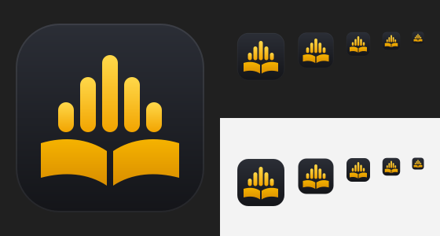

# Audiobook Generator



Turns Markdown scripts (`*_SCRIPT.md`) into MP3 audiobooks with ElevenLabs (Eleven v4):
parallel generation, resumable runs, a pre-flight pronunciation check, loudness-normalised
and tagged MP3s, and a built-in player with a clickable waveform.

## Setup on a new machine

1. Install Python 3.11+ and [FFmpeg](https://ffmpeg.org/) (FFmpeg must be on `PATH`, e.g. `winget install ffmpeg`).
2. Install the dependencies:

   ```
   pip install -r requirements.txt
   ```

3. Copy `.env.example` to `.env` and set `ELEVENLABS_API_KEY`.

## Run

```
python run.py
```

The whole program lives in this folder; copy the folder to use it elsewhere.
Never share or commit the `.env` file, it holds the API key.

Optional: `pip install -e .` installs the package with an `audiobook-generator` command.

## Develop

```
pip install -e ".[dev]"
python -m pytest
ruff check .
```

Tests run offscreen in seconds, use a fake ElevenLabs client (no paid requests) and never
read the real `.env`.

## Layout

```
AudiobookGenerator/
├── run.py                      start the app (no install needed)
├── src/                        code container, kept apart from tests, docs and config
│   └── audiobook_generator/    the Python package; the folder name is the import name
│       ├── app.py              application entry point
│       ├── core/               engine: config, text, preflight, worker
│       └── ui/                 Qt: main window, player, theme, assets
├── tests/                      pytest suite
├── docs/                       architecture, script-writing guide, images
├── pyproject.toml              package metadata, ruff/pytest/pyright settings
├── requirements.txt            runtime dependencies
└── .env / .env.example         API key (never commit .env)
```

## Docs

- [Architecture](docs/architecture.md): modules, generation pipeline, cache, threading.
- [Writing scripts](docs/script-writing.md): what Eleven v4 reads well and what to avoid.
- [Roadmap](docs/roadmap.md): ideas for students, ranked by impact.
